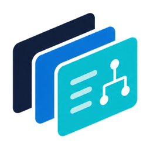

<p align="center">
  
</p>

<h1 align="center">OpenADUC</h1>

<p align="center">
  <strong>Manage users, groups, computers, and OUs from a browser — with a real audit trail behind every change.</strong>
</p>

<p align="center">
  <a href="LICENSE"></a>
  
  
</p>

---

OpenADUC is an open-source replacement for the legacy Microsoft "Active Directory Users and Computers" MMC snap-in. It runs as a small self-hosted web app, talks to your domain controllers over LDAPS, and gives sysadmins a fast, browser-based way to find users, computers, groups, and OUs; reset passwords; unlock accounts; manage memberships; and review what changed and who did it — without remoting into a Windows server.

It is built for small-to-mid-size IT teams that want a UI more responsive than the MMC, an audit trail more complete than the Windows event log, and a deployment story simpler than RSAT-on-a-jump-box.

## Screenshots

<!-- TODO(v0.1.0): replace with current UI captures before tagging -->
<!-- Suggested: dashboard, user search, user detail (account/groups/audit), group policy list -->

## Requirements

OpenADUC is designed to run on a single small Linux host. The application — and, optionally, its database — run as containers; nothing is installed on the host beyond Docker.

### Host

The numbers below are sized to comfortably cover a directory of up to roughly **10,000 users / groups / computers / OUs** in cache. They are starting points, not measured figures — most small-to-mid IT shops will run with substantial headroom, and very small directories can run on noticeably less (see below).

|        | Minimum                               | Recommended                             |
| ------ | ------------------------------------- | --------------------------------------- |
| OS     | 64-bit Linux (x86_64 or arm64)        | Debian 13 or Ubuntu 24.04 LTS           |
| CPU    | 2 vCPU                                | 4 vCPU                                  |
| RAM    | 2 GB                                  | 4 GB                                    |
| Disk   | 5 GB (external DB) / 10 GB (embedded) | 10 GB (external DB) / 20 GB+ (embedded) |
| Docker | Engine 24+ with the Compose v2 plugin | Latest stable Docker Engine             |

- **Disk** is dominated by the embedded Postgres volume (data + WAL + audit history, which grows one row per write over time). With **external** Postgres, the host only stores container images, logs, and the install directory — a couple of GB is plenty.
- **Very small directories (a few hundred users, e.g. ~100):** 1 vCPU and 1 GB RAM is enough, particularly with external Postgres. The API container uses roughly 200 MB resident, the web container ~20 MB, and an embedded Postgres works happily in 200–300 MB at this scale.
- **Larger directories (well past 10k objects):** give Postgres more RAM, or move it off-host. The API and web containers do not need to scale up.
- macOS is fine for local evaluation but is not a supported production target.

### Network

- **Outbound TCP/636 (LDAPS)**, or TCP/389 with StartTLS, to your domain controllers — how OpenADUC reads and writes AD. Unencrypted LDAP is not supported.
- **Inbound TCP/443** for the web UI, terminated by a reverse proxy you provide (nginx, Caddy, Traefik, …). The bundled web container speaks plain HTTP on port 8080 and is not safe to expose without TLS in front.
- No outbound internet access is required at runtime once the container images are pulled.

### Database

OpenADUC stores its cache, sessions, and audit log in **PostgreSQL only** — there is no MySQL / SQL Server / SQLite path. Two deployment options:

**Embedded (default).** The installer runs a Postgres 16 container alongside the app with a Docker volume for storage. Zero configuration; suitable for evaluation and small-to-mid-size production.

**External.** Point OpenADUC at a Postgres you already operate — on-prem cluster, AWS RDS, Google Cloud SQL, Azure Database for PostgreSQL, Supabase, etc. Requirements:

- PostgreSQL **14 or newer** (16 recommended; tested against 16).
- A dedicated database (e.g. `CREATE DATABASE openaduc`).
- A role that owns that database, or has `CREATE` on it — migrations build the schema on first start.
- The `pgcrypto` and `pg_trgm` extensions available. Both ship with every supported Postgres release and are on the allow-list of every major managed provider; pre-create them as a superuser, or grant the app role permission to `CREATE EXTENSION`.

Storage growth is driven mostly by the audit log (one row per write) and the directory cache (one row per user / group / computer / OU). A typical small-to-mid-size domain stays well under 1 GB for a long time.

### Active Directory

- A domain controller reachable over LDAPS, with a certificate the host trusts (or installed into the OpenADUC container's trust store).
- A service account for OpenADUC. Read-only is enough for cache sync; password reset, unlock, and attribute writes require delegated permissions on the OUs you intend to manage. The first-run setup wizard walks you through this.

## Quick install

One line on a Linux host with Docker:

```bash
curl -fsSL https://raw.githubusercontent.com/OpenADUC/openaduc/main/install.sh | bash
```

The installer prompts for an install directory, asks whether to use the bundled Postgres or an existing one, generates strong secrets, and brings the stack up. Then open the printed URL in a browser to run the first-run setup wizard.

For the manual path (clone, edit env, `docker compose up`), see [docs/installation.md](docs/installation.md).

## Security & deployment

OpenADUC sits in front of Active Directory and writes to it on behalf of operators. A compromised OpenADUC session can do anything its operator's role allows in AD — reset passwords, unlock accounts, edit attributes, change group memberships. Treat the host that runs it like any other tier-0 admin tool.

### Where to put it

**Recommended: keep OpenADUC on your internal network.** Reach it from your management VLAN, a jump host, an existing VPN, or a zero-trust overlay (Tailscale, Twingate, Cloudflare Access, …). You already restrict who can run RSAT or remote into a DC — apply the same posture here.

**If you must expose it to the public internet**, do not point port 443 at the bundled web container directly. Put it behind an **identity-aware proxy that enforces MFA** before requests reach OpenADUC. Concrete options:

- [Authentik](https://goauthentik.io/) or [Keycloak](https://www.keycloak.org/) with TOTP / WebAuthn / passkeys required.
- [Cloudflare Access](https://www.cloudflare.com/zero-trust/products/access/), [Pomerium](https://www.pomerium.com/), or [oauth2-proxy](https://oauth2-proxy.github.io/oauth2-proxy/) backed by an MFA-capable IdP.
- [Microsoft Entra Application Proxy](https://learn.microsoft.com/entra/identity/app-proxy/) with Conditional Access — a natural fit if you already run Entra ID.

With a proxy in front of the bundled web container, set `TRUST_PROXY_HOPS=2` so sign-in rate limits and the audit log see the real client address (see [configuration](docs/configuration.md)).

This is defence in depth, not SSO replacement: the proxy enforces MFA at the network boundary, and operators then sign in to OpenADUC with their AD credentials. OpenADUC does not (yet) consume proxy-asserted identity headers.

### What OpenADUC does and does not provide

- **AD-password authentication only — no application-layer MFA today.** Every sign-in performs a live LDAPS bind against your DCs; there is no in-app password store and no local break-glass account. If you cannot rely on network controls to keep untrusted users out, gate the app with MFA at a proxy.
- **Step-up re-auth on every write.** Mutating calls require re-entering the AD password; the elevated session ends after 15 idle minutes or 4 hours (defaults) and password material lives only in process memory.
- **Append-only audit log.** Database triggers reject `UPDATE`, `DELETE`, and `TRUNCATE` on `audit_events`; even a compromised app cannot silently rewrite history.
- **Encrypted secrets at rest.** Service-account passwords, Entra client secrets, and Teams webhooks are AES-256-GCM encrypted with `ENCRYPTION_KEY`. Back this key up alongside your database backups — losing it makes those rows unrecoverable.
- **No TLS in the box.** The bundled web container speaks plain HTTP on `:8080`; you terminate TLS in front (nginx, Caddy, Traefik, or your IdP proxy). It sends a strict Content-Security-Policy, refuses framing, and adds HSTS when your proxy forwards `X-Forwarded-Proto: https`.

For the threat model, capability list, step-up flow, and AD-specific risks, see [docs/security.md](docs/security.md).

### Hardening checklist

- Restrict the AD security group that grants `admin` to a small set of accounts that already use MFA at the AD/Entra layer.
- Delegate the service account's write permissions to **only the OUs OpenADUC manages**, not domain-wide.
- Back up `.env` (which holds `ENCRYPTION_KEY` and `SESSION_COOKIE_SECRET`) alongside your database backups.
- Forward `audit_events` to a SIEM if you need long-term, off-host retention.

## Documentation

- [Installation](docs/installation.md) — one-line install, manual install, first-run wizard
- [Configuration](docs/configuration.md) — every environment variable, defaults, and meaning
- [Architecture](docs/architecture.md) — request flow, data layer, directory provider abstraction
- [Security](docs/security.md) — threat model, capabilities, step-up, audit, AD-specific risks
- [Development](docs/development.md) — local dev workflow, prerequisites, common tasks

## What's in the box

| Surface             | What you can do today                                                                                                                                                                                                                                                                                                                                                                                                                                                                                                                                                                                                                                                                                                                                                                                                                                                                                                                                                                                                                                                                                                                                                                                                                                                                                                                                                                                                                                                                                                                                                                                                                                                                                                                                                                                                                                                                                                                                                                                                                                                                                                                                                                                                                                                                                                                                                                                                                                                                                              |
| ------------------- | ------------------------------------------------------------------------------------------------------------------------------------------------------------------------------------------------------------------------------------------------------------------------------------------------------------------------------------------------------------------------------------------------------------------------------------------------------------------------------------------------------------------------------------------------------------------------------------------------------------------------------------------------------------------------------------------------------------------------------------------------------------------------------------------------------------------------------------------------------------------------------------------------------------------------------------------------------------------------------------------------------------------------------------------------------------------------------------------------------------------------------------------------------------------------------------------------------------------------------------------------------------------------------------------------------------------------------------------------------------------------------------------------------------------------------------------------------------------------------------------------------------------------------------------------------------------------------------------------------------------------------------------------------------------------------------------------------------------------------------------------------------------------------------------------------------------------------------------------------------------------------------------------------------------------------------------------------------------------------------------------------------------------------------------------------------------------------------------------------------------------------------------------------------------------------------------------------------------------------------------------------------------------------------------------------------------------------------------------------------------------------------------------------------------------------------------------------------------------------------------------------------------ |
| **Dashboard**       | Sync status, recent activity, and accounts needing attention, each with its fix (unlock, reset password, extend expiry)                                                                                                                                                                                                                                                                                                                                                                                                                                                                                                                                                                                                                                                                                                                                                                                                                                                                                                                                                                                                                                                                                                                                                                                                                                                                                                                                                                                                                                                                                                                                                                                                                                                                                                                                                                                                                                                                                                                                                                                                                                                                                                                                                                                                                                                                                                                                                                                            |
| **Users**           | Search, view, create (names from the domain's naming pattern; a random, generated or typed password), copy (OU, organisation details and groups, as ADUC's Copy), prepare an import of up to 500 users pasted from Excel or a CSV file (columns mapped from their headers, names reviewed against the naming pattern, rows grouped into buckets whose OU and groups are remembered as placement rules, then a final check against the directory, which also warns when the licenses its groups grant are short of seats or would only come through a nested group) and run it as a server-side job that creates each account (with its usage location in `msExchUsageLocation`, for Connect Sync to carry to Entra, where the schema has that attribute), sets its password, enables it, adds its bucket's groups and sets its manager, then reports, once each person has synced to Entra, any license their groups' group-based licensing couldn't assign and why, retries a partly set up account without creating it again, hands out generated or shared passwords in a results CSV downloadable once within 24 hours, resets the new accounts' passwords in bulk once those are gone, and can issue each new hire a Temporary Access Pass for their onboarding class, made once they're in Entra and handed out from the import's class roster), see why someone can't sign in, edit attributes, rename (logon names and email included), reset passwords, issue a Temporary Access Pass to a user synced to Microsoft Entra (with the Entra integration's feature turned on), see a synced user's Microsoft licenses, each from a group or assigned directly, and why Entra couldn't assign one (read-only, with the Entra integration's licenses feature turned on), unlock, enable/disable, set account expiry, move OU, delete disabled accounts in bulk, disable, enable or unlock in bulk, add to or remove from groups in bulk, edit organisation and address attributes in bulk (each field left unchanged, set or cleared), or move users, set or clear their account expiry, make them change their password at next sign-in or clear "password never expires" in bulk, or move some or all of a departing manager's direct reports to a new manager, after a preview of what changes, as a server-side job (it carries on if you close the tab; failed accounts can be retried, and a stopped job can be reverted), select users for bulk actions by pasting a list of emails, usernames or names |
| **Groups**          | Search, view members and memberOf, add/remove members                                                                                                                                                                                                                                                                                                                                                                                                                                                                                                                                                                                                                                                                                                                                                                                                                                                                                                                                                                                                                                                                                                                                                                                                                                                                                                                                                                                                                                                                                                                                                                                                                                                                                                                                                                                                                                                                                                                                                                                                                                                                                                                                                                                                                                                                                                                                                                                                                                                              |
| **Computers**       | Search, view, disable/enable, reset account, move OU                                                                                                                                                                                                                                                                                                                                                                                                                                                                                                                                                                                                                                                                                                                                                                                                                                                                                                                                                                                                                                                                                                                                                                                                                                                                                                                                                                                                                                                                                                                                                                                                                                                                                                                                                                                                                                                                                                                                                                                                                                                                                                                                                                                                                                                                                                                                                                                                                                                               |
| **OUs**             | Browse the directory tree                                                                                                                                                                                                                                                                                                                                                                                                                                                                                                                                                                                                                                                                                                                                                                                                                                                                                                                                                                                                                                                                                                                                                                                                                                                                                                                                                                                                                                                                                                                                                                                                                                                                                                                                                                                                                                                                                                                                                                                                                                                                                                                                                                                                                                                                                                                                                                                                                                                                                          |
| **Group Policy**    | List GPOs, inspect linked OUs, view enabled CSE extensions                                                                                                                                                                                                                                                                                                                                                                                                                                                                                                                                                                                                                                                                                                                                                                                                                                                                                                                                                                                                                                                                                                                                                                                                                                                                                                                                                                                                                                                                                                                                                                                                                                                                                                                                                                                                                                                                                                                                                                                                                                                                                                                                                                                                                                                                                                                                                                                                                                                         |
| **Password policy** | View domain default and fine-grained policies                                                                                                                                                                                                                                                                                                                                                                                                                                                                                                                                                                                                                                                                                                                                                                                                                                                                                                                                                                                                                                                                                                                                                                                                                                                                                                                                                                                                                                                                                                                                                                                                                                                                                                                                                                                                                                                                                                                                                                                                                                                                                                                                                                                                                                                                                                                                                                                                                                                                      |
| **Quick search**    | Ctrl+K finds users, groups, computers and OUs; start with unlock, reset, enable or disable (`unlock jdoe`) to act on a user without opening their page                                                                                                                                                                                                                                                                                                                                                                                                                                                                                                                                                                                                                                                                                                                                                                                                                                                                                                                                                                                                                                                                                                                                                                                                                                                                                                                                                                                                                                                                                                                                                                                                                                                                                                                                                                                                                                                                                                                                                                                                                                                                                                                                                                                                                                                                                                                                                             |
| **Keyboard**        | `/` searches a list, `j`/`k` and Enter open rows; object pages: `u` `r` `e` `m` (unlock, reset, enable/disable, move), `a` add member, `1`–`9` tabs; `?` lists them; off switch in Appearance                                                                                                                                                                                                                                                                                                                                                                                                                                                                                                                                                                                                                                                                                                                                                                                                                                                                                                                                                                                                                                                                                                                                                                                                                                                                                                                                                                                                                                                                                                                                                                                                                                                                                                                                                                                                                                                                                                                                                                                                                                                                                                                                                                                                                                                                                                                      |
| **Audit**           | Every write is logged with actor, target, before/after, and step-up status; a bulk job shows as one entry, which can be reverted (a new job puts back each account's before-values, leaving accounts changed since unless you include them)                                                                                                                                                                                                                                                                                                                                                                                                                                                                                                                                                                                                                                                                                                                                                                                                                                                                                                                                                                                                                                                                                                                                                                                                                                                                                                                                                                                                                                                                                                                                                                                                                                                                                                                                                                                                                                                                                                                                                                                                                                                                                                                                                                                                                                                                        |
| **Setup wizard**    | First-run flow: directory connection, service account, policy, initial sync                                                                                                                                                                                                                                                                                                                                                                                                                                                                                                                                                                                                                                                                                                                                                                                                                                                                                                                                                                                                                                                                                                                                                                                                                                                                                                                                                                                                                                                                                                                                                                                                                                                                                                                                                                                                                                                                                                                                                                                                                                                                                                                                                                                                                                                                                                                                                                                                                                        |

## Stack

- **Backend**: Node.js 22, TypeScript, [Fastify](https://fastify.dev/)
- **Directory**: [ldapts](https://github.com/ldapts/ldapts) over LDAPS
- **Database**: PostgreSQL 16, [Kysely](https://kysely.dev/) (queries), [Knex](https://knexjs.org/) (migrations)
- **Background work**: in-process scheduler with per-directory sync tasks (delta + periodic full sync)
- **Frontend**: Vue 3, Vite, [PrimeVue](https://primevue.org/), Tailwind v4, Pinia
- **Tooling**: pnpm workspaces, ESLint, Prettier, Vitest

## Status

Pre-1.0. Suitable for evaluation, lab use, and adventurous early adopters running on a single small/mid-size domain. Expect rough edges. Bug reports and PRs welcome.

The roadmap toward v1.0 includes: bulk operations, scheduled reports, an integrations panel (Entra ID, SCIM), and richer Group Policy editing.

## License

OpenADUC is licensed under the [Business Source License 1.1](LICENSE). You may run it in production for your own organization at no cost. Offering OpenADUC (or a substantial portion of its functionality) as a hosted service to third parties is not permitted under the BSL grant.

The license converts to **Apache License 2.0 on 2030-05-09**, four years after the first public release.

## Links

- Website — [openaduc.com](https://openaduc.com)
- Issues — [github.com/OpenADUC/openaduc/issues](https://github.com/OpenADUC/openaduc/issues)
- Security — see [SECURITY.md](SECURITY.md) for private vulnerability reporting
